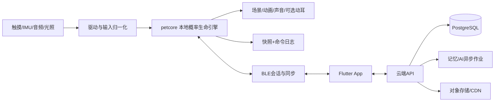

# 系统架构与固件

## 组件边界



建议 ESP-IDF + FreeRTOS、C++可移植核心、LVGL负责UI，角色渲染独立Scene层；SDK/组件版本在首轮工程构建中锁定，不能以浮动latest发布。宿主机与设备复用petcore，不在Python和固件各写一套规则。

## 核心接口草案

```cpp
Result step(PetState&, Duration dt, Inputs, Config const&, EventSink&);
Result handle(PetState&, Command const&, Config const&, EventSink&);
Intent choose_action(PetState&, Context const&, RandomStreams&);
Snapshot serialize(PetState const&);
Result restore(Snapshot const&, ConfigRegistry const&);
```

输入命令严格校验，核心单线程写。渲染、音频、蓝牙通过队列交互，不直接改State。日常命令先本地持久化，成功后反馈奖励；只读取投影UI，避免同帧竞态。core不依赖设备时钟、网络、malloc频繁分配或云SDK。

## 调度与并发

| 任务 | 工作 | 约束 |
|---|---|---|
| input | 触摸/键/IMU归一化 | 中断只入队，不做渲染或写Flash |
| petcore | 60秒生理步，事件驱动行为 | 唯一状态写入者，可追赶计算 |
| scene | 20—30fps插值，物理30Hz | 不抽生死随机数 |
| audio | I2S DMA/唤醒/播放 | 缓冲有界，避免网络堵塞 |
| connectivity | BLE/Wi-Fi及同步 | 背压、重试、限时 |
| persistence | 快照/日志落盘 | 关键终态同步确认 |
| supervisor | 电量、看门狗、健康自检 | 故障不映射宠物病情 |

优先级与核绑定按trace数据决定，不提前宣称特定分配最优。内存需静态预算：显示、音频环缓冲、模型、BLE栈、core、资源缓存分别测峰值；留20%候选余量。

## 存储及时间

快照采用双槽 generation+schema_version+CRC，写新槽、校验、更新指针。重要命令WAL先追加，定期压缩；使用磨损均衡，控制写频，关键死亡、交易、身份迁移立即落盘。断电恢复最新完整快照后重放未压缩命令，command_id去重。CRC只检错，不防篡改；认证使用设备密钥与签名。

掉电前保存不作为唯一保障。Flash完全坏时由云备份恢复到替代设备，保留数据缺失提示。未同步的数据无法凭空找回，不承诺零丢失。

## 权威与同步

- 宠物生理/行为：当前设备权威，云存副本；App传命令不直接改值。
- 账户、会员、可转移库存与赠礼账本：云端权威。
- 免费本地积分：设备日志产生，云按规则验算/去重；首发不可直接换付费或高价值可转移资产。
- 手机位置与记忆文案：附属资料，不反向覆盖生命状态。

每只宠物包含writer_epoch、device_seq、previous_event_hash。服务端按epoch/seq接受连续事件，缺口请求补传，不能只按最后更新时间覆盖。旧设备离线仍可玩本地分支，但迁移后其同步被拒；重新联机提供只读旧档与解释，不能合并两个生命结局。

## 迁移及冲突

正常迁移：旧设备冻结并上传终快照 → 云提升epoch绑定新设备 → 新设备确认恢复 → 旧设备解除活宠。旧机丢失：账户验证恢复最近备份，提升epoch，旧机状态撤销；新机保持保守恢复，不补未知期间死亡。已同步死亡不可用旧备份回滚；影子候选事件不作为终态。

检测篡改不处罚性杀死宠物，限制交易并提示修复。core配置升级使用版本迁移，不重抽遗传/seed；历史事件引用历史配置版本。

## OTA及内容更新

双应用槽、签名镜像、HTTPS、启动自检和回滚；遵循[ESP-IDF OTA官方机制](https://docs.espressif.com/projects/esp-idf/en/stable/esp32s3/api-reference/system/ota.html)。低电量/未充电不升级。签名密钥不入仓库；生产Secure Boot/Flash Encryption在量产流程验证可恢复性后启用。

资源使用signed manifest、hash、兼容core范围和分块下载。空间不足不能覆盖当前唯一可用资源；保留内置最小角色与UI，升级失败可回退。无法存双资源包时逐文件原子替换并提供兼容manifest，不能声称数据分区天然具有应用槽同等回滚能力。

启动自检包括存档、资源、音频、输入、看门狗；成功后才标记OTA有效。宠物生命与固件健康完全分开。
